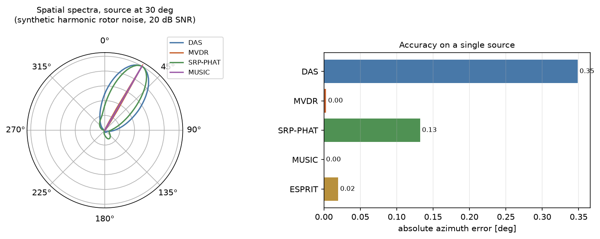
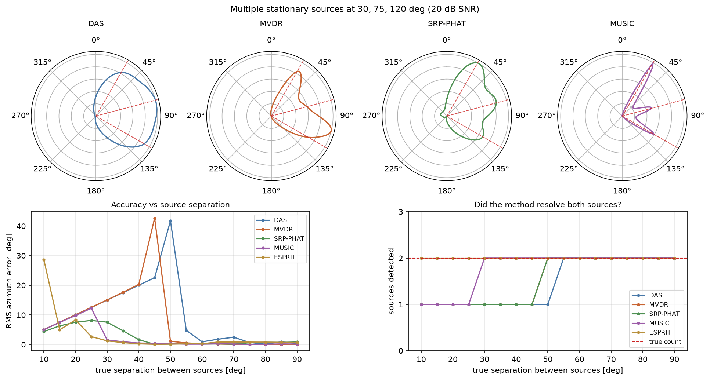
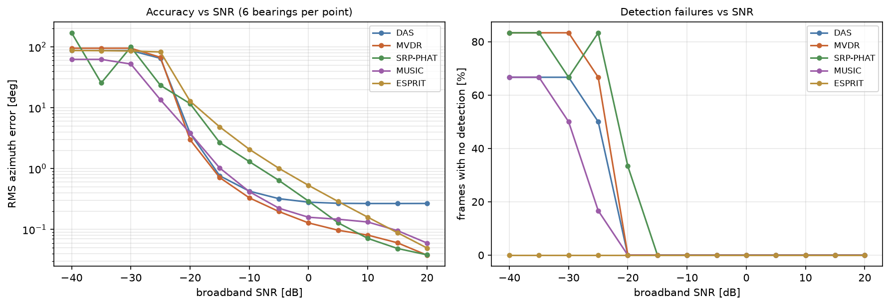

# Acoustic source localisation with a 4×4 microphone array

Direction-of-arrival estimation for small uncrewed aircraft from their rotor
noise, using a 16-element planar array. Passive, so nothing is radiated and
nothing gives the sensor away; cheap, because the whole aperture is 126 mm of
microphones rather than a radar front end.

Six estimators are implemented against one shared array model and compared on
the same simulated data: delay-and-sum, MVDR, SRP-PHAT, MUSIC, 2-D ESPRIT, and
direct TDOA geometry.

Built during a six-month R&D internship at BlueSpace Technology, as the
software half of a counter-UAV detection study. Accompanying paper:
*Multi-Source Direction Estimation using Acoustic Emission*.



---

## Results

Single source, synthetic rotor noise, 20 dB SNR, 500 ms frames, mean absolute
azimuth error over eight bearings spread around the compass:

| estimator | mean error | worst case | resolves two sources at | notes |
|---|---|---|---|---|
| **MVDR** | **0.02°** | 0.08° | 50° | adaptive nulling, needs a covariance inverse per bin |
| MUSIC | 0.03° | 0.14° | **30°** | best multi-source performance |
| ESPRIT | 0.04° | 0.07° | 10° * | parametric, no angular scan, tightest worst case |
| TDOA (row/column) | 0.07° | 0.13° | single source only | cheapest by far |
| SRP-PHAT | 0.09° | 0.17° | 50° | most robust under motion |
| delay-and-sum | 0.29° | 0.96° | 55° | aperture-limited, never fails |

\* ESPRIT always returns as many estimates as the model order it is given, so
"resolves" is not a threshold for it — judge it on RMS error.

No estimator failed to detect the source at any of the eight bearings.

Three stationary sources at 30°/75°/120°, 20 dB SNR:

| estimator | found | estimates | RMS error |
|---|---|---|---|
| MUSIC | 3 of 3 | 30.0°, 74.0°, 120.0° | **0.58°** |
| ESPRIT | 3 of 3 | 28.4°, 72.1°, 107.8° | 7.31° |
| MVDR | 2 of 3 | 32.0°, 104.0° | 20.6° |
| SRP-PHAT | 2 of 3 | 32.0°, 120.0° | 31.9° |
| delay-and-sum | 1 of 3 | 78.0° | 48.0° |

The beamformers are not failing: 126 mm of aperture simply cannot resolve three
sources 45° apart. That gap is the entire argument for subspace methods on a
small array.



### Robustness

Accuracy holds to roughly **−20 dB** broadband SNR and degrades sharply below
that. At high SNR, MVDR and SRP-PHAT reach 0.04°; delay-and-sum plateaus near 0.27°
because its broad main lobe biases the peak interpolation.



### Moving sources

Two effects, usually conflated, with different remedies:

- **Doppler time-scaling** warps the time axis by `α = c/(c − v_r)`. In the far
  field this is common to the whole array, so both direction cosines shrink
  equally and **azimuth is invariant** — under 0.2° error even at 60 m/s.
  Elevation, read from the cosine *magnitude*, absorbs the whole bias and is
  off by `arccos(1/α)` — 34° at 60 m/s. Resampling onto a uniform
  emission-time grid restores it to 0.00°.
- **Motion blur** is the bearing changing during the frame. It costs what the
  geometry says: 0.3–0.8° at 50 ms frames, 1.7–5.5° at 800 ms, for a 25 m/s
  pass at 15 m.

Details and the corrected analysis in [docs/doppler.md](docs/doppler.md).

---

## Quick start

```bash
git clone <this repository>
cd acoustic-source-localisation
python -m venv .venv && source .venv/bin/activate
pip install -e .
```

Run an experiment — no data download required, the default source is synthetic:

```bash
python experiments/exp1_single_stationary.py --azimuth 30 --snr 20
```

```
  method       estimate      error
  DAS           30.3 deg   +0.35 deg
  MVDR          30.0 deg   -0.00 deg
  SRP-PHAT      30.1 deg   +0.13 deg
  MUSIC         30.0 deg   -0.00 deg
  ESPRIT        30.0 deg   +0.02 deg
```

Use the library directly:

```python
import numpy as np
from arraylib import geometry, simulate, sources
from arraylib.detect import find_sources
from arraylib.estimators import music

positions = geometry.positions_array()
_, drone = sources.harmonic_drone(duration=0.5)

signals = simulate.simulate_stationary(drone, azimuth_deg=47.0, snr_db=20)

azimuths, spectrum, n = music(signals, positions)
peaks, noise_floor = find_sources(azimuths, spectrum)
print(peaks)        # [Peak(azimuth=47.0, power=1.000, snr_db=50.1)]
# Pass rng=np.random.default_rng(0) to simulate_stationary for a repeatable draw.
```

Run the tests:

```bash
python -m pytest tests/ -v          # or: python tests/test_estimators.py
```

---

## Repository layout

```
src/arraylib/
  config.py          constants, scan thresholds, the usable band and why
  geometry.py        element positions, channel map, subarrays, steering vectors
  sources.py         recorded WAV loading, synthetic rotor noise, band-pass
  simulate.py        far-field and Doppler forward models, compensation
  detect.py          activity gate, circular peak finding, angular error
  plotting.py        shared figure helpers
  estimators/
    gcc_phat.py      PHAT-weighted cross-correlation, sub-sample peak
    beamforming.py   delay-and-sum, MVDR, SRP-PHAT
    music.py         broadband MUSIC with MDL order selection
    esprit.py        2-D ESPRIT with joint-diagonalisation pairing
    hilbert.py       analytic-signal phase and envelope delay
    tdoa.py          row/column and least-squares direction from delays

experiments/         exp1 single, exp2 multi, exp3 moving, exp4 SNR, exp5 Doppler
realtime/live_doa.py live display, any estimator, from a connected array
tests/               21 tests, including regression tests for each fixed defect
docs/                array geometry, Doppler analysis, defect log
```

---

## The array

A planar 16-element grid at 42 mm spacing, captured at 48 kHz.

```
            x (east) →
        -63   -21   +21   +63  mm
      ┌─────────────────────────┐
 +63  │  08    07    10    09   │  row 3 (north)
 +21  │  06    05    12    11   │  row 2
 -21  │  04    03    14    13   │  row 1
 -63  │  02    01    00    15   │  row 0 (south)
      └─────────────────────────┘
   y (north) ↑     numbers are capture channels
```

Spacing sets the upper frequency bound: grating lobes appear beyond
`c/2d = 4.08 kHz`. Aperture sets the lower one — at 126 mm the array is
smaller than a wavelength below about 2.7 kHz and has almost no directivity
there. The usable band is therefore about **1.0–3.5 kHz**, a little under two
octaves, which is the central design tension of a small acoustic array.

Full discussion in [docs/array-geometry.md](docs/array-geometry.md).

---

## Live capture

```bash
pip install -e ".[realtime]"
sudo apt install libportaudio2        # PortAudio, for sounddevice

python realtime/live_doa.py --list-devices
python realtime/live_doa.py --method music --device 3
python realtime/live_doa.py --method srp --frame 0.1 --text
```

One script covers every estimator. `sounddevice` is an optional dependency and
is imported lazily, so the whole library and test suite work on a machine with
no audio stack at all.

---

## What this started as

Four repositories and about ninety loose scripts, written over the internship:
`Windy-signals` (propagation simulation) → `donut-phasing` (TDOA localisation)
→ `simply-aoa` (everything else). Consolidating them put several
implementations of the same quantity side by side for the first time, and a
number of them disagreed.

The substantive defects found and fixed:

| | defect | consequence |
|---|---|---|
| 1 | ESPRIT assigned the same subspace matrix to both subarrays | rotation operator was exactly the identity; reported angles carried **no** direction information |
| 2 | ESPRIT paired its two axes by sorting | two sources at 30°/120° reported as 135°/45° |
| 3 | Six copies of the array geometry had drifted | simulation and real-time code disagreed on 15 of 16 channel positions |
| 4 | PHAT whitening used an absolute magnitude floor | empty spectral bins amplified to unit magnitude; a known 20-sample delay measured as −0.25 |
| 5 | Cross-correlation search was unbounded | delays 29× larger than geometrically possible — **the real cause of the 60° errors** blamed on Doppler |
| 6 | Propagation delay had the wrong sign | every subspace and beamforming estimator reported the reciprocal bearing |
| 7 | Peak finder padded by less than one main lobe | sources at 0° discarded as insufficiently prominent |
| 8 | Processing band extended below the aperture limit | beamformers dragged towards the centroid of the sources |
| 9 | No sub-grid peak interpolation | 2° scan grid put a 1.00° floor under every measurement, hiding the SNR dependence entirely |

Each has a named regression test. The full account, with the measurements that
confirmed each one, is in [docs/findings.md](docs/findings.md).

Worth saying plainly: the physics and the method selection in the original work
were sound — the array design, GCC-PHAT for delay estimation, wideband methods
for moving sources, spatial Nyquist as the binding constraint on spacing. Most
of these are implementation errors sitting underneath correct reasoning, which
is exactly why they survived six months of use and only surfaced when two
implementations of the same quantity were placed next to each other.

---

## Method notes

**GCC-PHAT** divides the cross-spectrum by its magnitude, keeping only phase.
The correlation peak becomes sharp and largely independent of the source
spectrum — which matters for rotor noise, where plain cross-correlation is
dominated by whichever harmonic happens to be loudest. The magnitude floor must
be *relative* to the strongest bin; an absolute floor amplifies empty bins and
destroys the peak.

**Delay-and-sum** steers by applying each element's fractional delay and
summing. Wideband, never fails, resolution fixed by aperture.

**MVDR (Capon)** minimises output power subject to unit gain on the look
direction, placing nulls on interferers. Needs a covariance inverse per
frequency bin and diagonal loading to stay conditioned with few snapshots.

**SRP-PHAT** accumulates each pair's GCC-PHAT correlation at the delay a
candidate direction predicts. Correlations are computed once and only
*sampled* per direction, so refining the angular grid is cheap. Baseline length
matters more than pair count: switching from adjacent (42 mm) to perimeter
(126 mm) pairs took it from 0.67° with five detection failures to 0.09° with
none.

**MUSIC** eigendecomposes the per-bin covariance and scans for directions
orthogonal to the noise subspace. Resolution well beyond the aperture limit,
at the cost of needing the source count — estimated here by MDL — and assuming
mutually incoherent sources.

**ESPRIT** exploits the rotational invariance between two displaced subarrays
to get directions in closed form, with no angular scan and no grid
quantisation at all. That shows in its worst case, the tightest of the six
(0.07° against 0.08–0.96°), even though MVDR edges it on the mean. The two
axes must be paired by joint diagonalisation, not by sorting.

**Sub-sample interpolation is mandatory, not an optimisation.** At 48 kHz the
full 180° bearing span covers only about 35 samples of delay, so whole-sample
estimates would quantise azimuth into 5–10° steps. Both the correlation peak
and the spatial-spectrum peak are interpolated parabolically.

---

## Reproducing the figures

```bash
for f in experiments/exp*.py; do python "$f" --synthetic; done
python experiments/exp2_multi_stationary.py --synthetic --separation-sweep
python experiments/exp3_moving_source.py --synthetic --frame-sweep --velocity 25 --distance 15
python experiments/exp4_snr_sweep.py --synthetic --snr-min -40 --snr-max 20
```

Everything is seeded, so the numbers in this README reproduce exactly. Drop a
WAV at `data/drone_bebop_sample.wav` and omit `--synthetic` to run the same
experiments on recorded rotor noise — see [data/README.md](data/README.md).

---

## Licence

MIT, see [LICENSE](LICENSE). The code is original work from the internship;
no proprietary data, hardware designs, or client material is included. Any
third-party audio corpus used with it carries its own licence.
