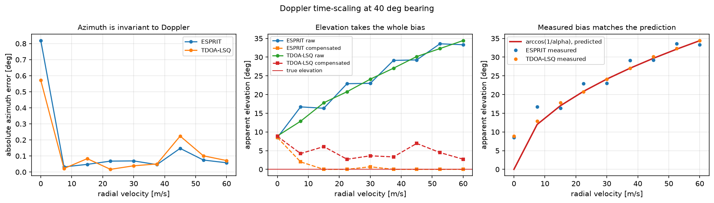
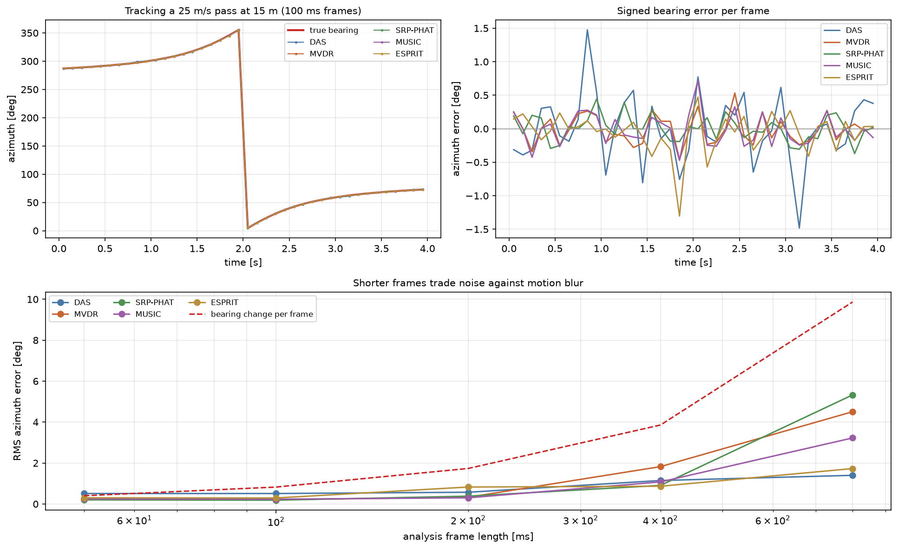

# Doppler and moving sources

A drone is never stationary, so every estimate in this project is made on a
source that is moving during the measurement. Two distinct effects follow, and
they are often conflated. They have different causes, different magnitudes and
different remedies, so this document separates them.

## The model

A source with radial velocity does not shift the received waveform in time, it
**rescales the time axis**:

```
x_m(t) = s( α(t) · t + τ_m ) + n_m(t)          α = c / (c − v_r)
```

where `τ_m` is the geometric advance at element `m` and `v_r` is positive when
the source approaches. `α > 1` compresses the waveform, raising pitch.

This is the formulation implemented in `simulate.simulate_moving`. It matters
that the Doppler shift is *not* applied as a separate frequency offset: writing
`sin(2π f_doppler · t_emit)` applies the effect twice, once through the shifted
frequency and once through the retarded time. The project's original
`doppler_simulation.py` did exactly that, while its README described the
correct single-mechanism model.

## Effect 1 — Doppler time-scaling

**Damages elevation. Leaves azimuth alone. Fully correctable.**

In the far field `α` is common to the whole array, so every inter-element delay
is divided by the same factor. The consequences split cleanly:

- **Azimuth** is `atan2(u, v)`. Both direction cosines shrink by the same `α`,
  and the ratio is unchanged, so azimuth is **invariant to Doppler**.
- **Elevation** is read from the magnitude `hypot(u, v)`, which is not
  scale-invariant. The entire bias lands here: a source in the horizontal plane
  appears to climb by `arccos(1/α)`.

Measured against the closed form (`exp5`, ESPRIT, 500 ms frames, 20 dB SNR):

| v_r | α | predicted `arccos(1/α)` | measured | azimuth error |
|---|---|---|---|---|
| 15 m/s | 1.0457 | 17.4° | 16.3° | 0.05° |
| 30 m/s | 1.0958 | 24.4° | 23.0° | 0.07° |
| 45 m/s | 1.1510 | 29.8° | 29.3° | 0.15° |
| 60 m/s | 1.2120 | 34.4° | 33.3° | 0.06° |



### Compensation

Because the warp is common to the array, it can be undone before any DOA
processing. Integrating the Doppler factor gives the warped time
`u(t) = ∫ α dξ`; inverting that mapping and resampling every channel onto a
uniform `u` grid restores a common waveform. The same warp is applied to all
channels, so the inter-channel delays carrying the direction information
survive intact.

`simulate.compensate_time_scaling` does this, and it returns elevation to
**0.00°** at every speed tested.

In a deployed system `α` is not known a priori. It can be estimated from the
drift of a tracked harmonic, or searched over as a one-dimensional parameter —
the spatial spectrum sharpens markedly at the correct value, which makes it
self-indicating.

## Effect 2 — motion blur

**Damages everything. Not correctable within a frame, only traded off.**

Separately from Doppler, the bearing itself changes during the analysis window,
so a long frame has no single correct answer. The angular rate at closest
approach is

```
ω = v / r
```

For 10 m/s at 50 m that is 0.2 rad/s, or **11.5 °/s** — about 5.7° of smear in
a 0.5 s frame.

The only remedy inside a single frame is to shorten it, which trades motion
blur against noise and frequency resolution. Measured on a deliberately
aggressive pass (25 m/s at 15 m, `exp3 --frame-sweep`):

| frame | bearing change per frame | DAS | MVDR | SRP-PHAT | MUSIC | ESPRIT |
|---|---|---|---|---|---|---|
| 50 ms | 0.4° | 0.81° | 0.57° | 0.56° | 0.57° | 0.30° |
| 100 ms | 0.8° | 0.95° | 0.61° | 0.64° | 0.61° | 0.29° |
| 200 ms | 1.7° | 0.94° | 0.59° | 0.76° | 0.59° | 0.83° |
| 400 ms | 3.9° | 1.19° | 1.95° | 1.03° | 1.19° | 0.87° |
| 800 ms | 9.9° | 1.75° | 4.53° | 5.49° | 2.86° | 1.73° |



Error tracks the per-frame bearing change, as it should. The narrowband-ish
methods degrade fastest at long frames; 100–200 ms is the sweet spot for this
geometry.

## Correcting the original analysis

The project's original `DOPPLER_ANALYSIS.md` concluded that TDOA estimation
"fails catastrophically" for moving sources, reporting 60–126° RMS bearing
error. That conclusion does not survive checking, for three reasons.

| quantity | original | actual | overstated |
|---|---|---|---|
| angular velocity (10 m/s at 50 m) | 350 °/s | 11.46 °/s | 31× |
| bearing change in 0.5 s | 175° | 5.73° | 31× |
| measured TDOA, 120 mm array | ±10 ms | ±350 µs possible | 29× |

The third is decisive. A 120 mm baseline cannot produce a delay beyond
`0.120/343 = 350 µs`. Reported delays of ±10 ms are 29× physically impossible,
so the correlation search was unbounded and locking onto noise peaks rather
than arrivals. The 60° errors were a search-bounds bug, not a physical limit.

With the search bounded to each pair's geometry
(`max_tau = margin · baseline / c`), the same class of scenario costs 0.3–5.5°
depending on frame length. Motion is a real and measurable effect; it is not
catastrophic, and it does not dominate azimuth the way the original notes
suggested.

## Practical guidance

1. **Bound every correlation search** by the pair's own baseline. This is the
   single highest-value line of code in the delay path.
2. **Use 100–200 ms frames** for sources under about 25 m/s at tactical range.
   Shorter buys little; longer loses coherence.
3. **Do not worry about Doppler for bearing.** It is invariant, and effort
   spent compensating it buys nothing in azimuth.
4. **Do compensate before trusting elevation**, or treat elevation as
   unreliable on a fast-closing target — at 60 m/s a level target appears 34°
   high.
5. **Prefer wideband methods under motion.** SRP-PHAT and delay-and-sum average
   over frequency and degrade gracefully; narrowband steering at a single
   assumed frequency does not.
